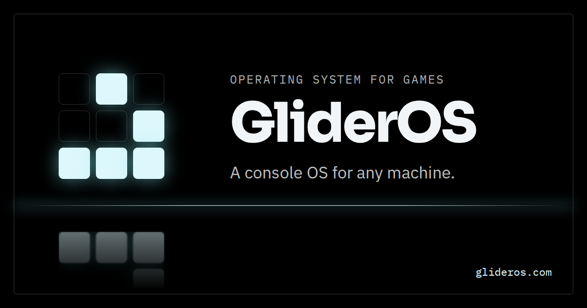

  

  <a href="#english">English</a> · <a href="#español">Español</a>

---

## English

### What GliderOS is

GliderOS is an operating system written from scratch only for games. It is not a launcher, not
an emulator and not Linux. When the machine starts, it boots straight into games, and every
core, the graphics chip and the memory work for the game you are playing.

Build your console the way you build a computer: anything with a CPU, RAM and a GPU is a
console waiting to happen.

Read more on the official website: **[glideros.com](https://glideros.com)**.

### Where it is now

GliderOS is in exploration and development. Today it runs on a Mac mini M1. That is the first
machine, not the last one.

There is no public image or download yet. For the real, up-to-date progress, see the
**[roadmap](https://glideros.com/roadmap/)**. The website is the only source of truth for the
state of the project.

### When the code comes

The code is not public yet. It will be published **in this repository** when the roadmap
reaches its last stage, "Open source", so anyone can learn from it, improve it and build for
GliderOS. There is no date for it.

The licence will be chosen and added together with the code.

### What you can do now

- **Watch** this repository: click **Watch → Custom → Releases**, and GitHub will tell you
  when the first release is out.
- **Star** it, so you can find it again easily.
- Follow the news on **[glideros.com](https://glideros.com)**.

---

## Español

### Qué es GliderOS

GliderOS es un sistema operativo escrito desde cero solo para jugar. No es un launcher, no es
un emulador y no es Linux. Cuando la máquina arranca, entra directamente en los juegos, y todos
los núcleos, el chip gráfico y la memoria trabajan para el juego al que estás jugando.

Monta tu consola como montas un ordenador: todo lo que tenga CPU, RAM y GPU es una consola en
potencia.

Lee más en la web oficial: **[glideros.com](https://glideros.com/es/)**.

### Dónde está ahora

GliderOS está en exploración y desarrollo. Hoy funciona en un Mac mini M1. Es la primera
máquina, no la última.

Todavía no hay imagen pública ni descarga. Para ver el progreso real y al día, consulta la
**[hoja de ruta](https://glideros.com/es/roadmap/)**. La web es la única fuente de verdad sobre
el estado del proyecto.

### Cuándo llega el código

El código todavía no es público. Se publicará **en este repositorio** cuando la hoja de ruta
llegue a su última etapa, «Código abierto», para que cualquiera pueda aprender de él, mejorarlo
y crear para GliderOS. No tiene fecha.

La licencia se elegirá y se añadirá junto con el código.

### Qué puedes hacer ahora

- **Sigue** este repositorio: pulsa **Watch → Custom → Releases** y GitHub te avisará cuando
  salga la primera versión.
- Dale una **estrella** para encontrarlo fácilmente.
- Sigue las novedades en **[glideros.com](https://glideros.com/es/)**.
